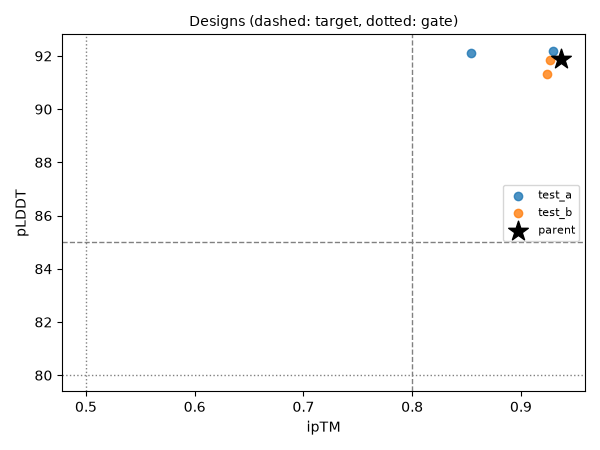
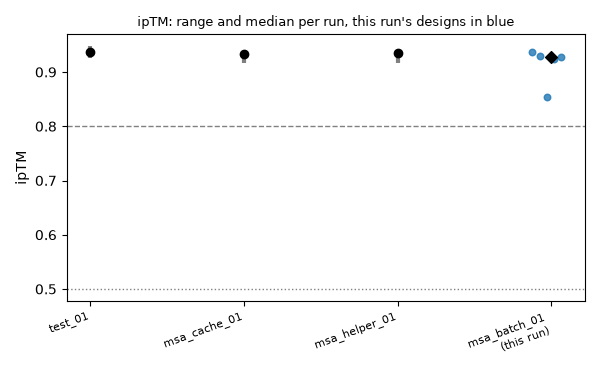

# Run msa_batch_01: batched-fold

**5/5 designs pass all gates · best ipTM 0.94 · parent 0.94 · earlier best run msa_cache_01: 7/7**

Created 2026-10-30 13:28 UTC · models boltz · seeds n/a · code `34bf9ba` · GPU job 411594

ok = reaches the target, ! = passes the gate but misses the target, ✗ = fails the gate. Thresholds are in `thresholds.toml`.

## Scorecard

| Metric | Median | Range | Parent | Best earlier median | ok / warn / fail |
|---|---|---|---|---|---|
| ipTM | 0.93 | 0.85 to 0.94 | 0.94 | 0.94 | 5 / 0 / 0 |
| pLDDT | 91.9 | 91.3 to 92.2 | 91.9 | 91.8 | 5 / 0 / 0 |
| pTM | 0.94 | 0.90 to 0.95 | 0.95 | 0.95 | 5 / 0 / 0 |

## Designs

| Design | Model | Group | Mutations | ipTM | pLDDT | pTM | Δ ipTM | Result |
|---|---|---|---|---|---|---|---|---|
| wt_model_0-batch_a (parent) | boltz | parent | - | 0.94 ✓ | 91.9 ✓ | 0.95 ✓ | +0.00 | pass |
| v1_model_0-batch_a | boltz | test_a | VH:S17T+VH:T69S+VH:S71T+VH:D90E+VL:T85S | 0.93 ✓ | 92.2 ✓ | 0.94 ✓ | -0.01 | pass |
| v4_model_0-batch_a | boltz | test_b | VH:S25T+VH:A88S+VL:Q3E+VL:V19I+VL:T69S | 0.93 ✓ | 91.8 ✓ | 0.94 ✓ | -0.01 | pass |
| v3_model_0-batch_a | boltz | test_b | VH:I70V+VH:A88S+VL:V15I+VL:S67T+VL:E81D | 0.92 ✓ | 91.3 ✓ | 0.94 ✓ | -0.01 | pass |
| v2_model_0-batch_a | boltz | test_a | VH:Q13E+VH:S21T+VH:A23S+VH:S75T+VL:S14T | 0.85 ✓ | 92.1 ✓ | 0.90 ✓ | -0.08 | pass |

Showing 5 of 5 designs, passing first, best ipTM first.

## Two metrics at once

## Compared with earlier runs

| Run | Created | Models | Designs | Pass | ipTM median | ipTM best |
|---|---|---|---|---|---|---|
| test_01 | 2026-10-30 09:06 UTC | boltz | 5 | 5 (100%) | 0.94 | 0.95 |
| msa_cache_01 | 2026-10-30 12:03 UTC | boltz | 7 | 7 (100%) | 0.93 | 0.94 |
| msa_helper_01 | 2026-10-30 12:15 UTC | boltz | 5 | 5 (100%) | 0.93 | 0.94 |
| msa_batch_01 (this run) | 2026-10-30 13:28 UTC | boltz | 5 | 5 (100%) | 0.93 | 0.94 |

## Groups

test_a: 2, test_b: 2, parent: 1

## Files

`designs.csv` (one row per design with every score and grade), `summary.json` (numbers for the leaderboard).
