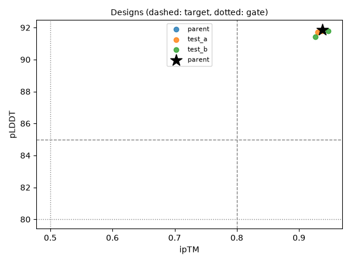
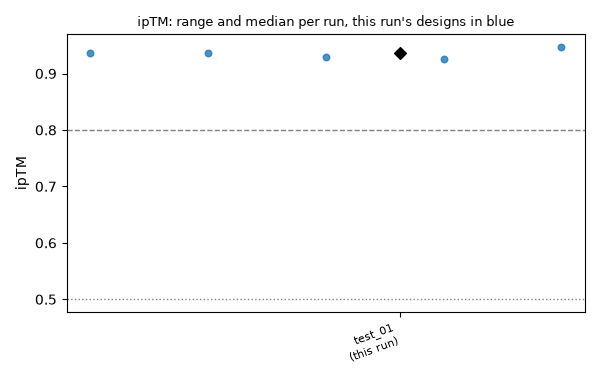

# Run test_01: plumbing-test

**5/5 designs pass all gates · best ipTM 0.95 · parent 0.94**

Created 2026-10-30 09:06 UTC · models boltz · seeds 0 · code `34bf9ba` · GPU job 411146

ok = reaches the target, ! = passes the gate but misses the target, ✗ = fails the gate. Thresholds are in `thresholds.toml`.

## Scorecard

| Metric | Median | Range | Parent | Best earlier median | ok / warn / fail |
|---|---|---|---|---|---|
| ipTM | 0.94 | 0.93 to 0.95 | 0.94 | - | 5 / 0 / 0 |
| pLDDT | 91.8 | 91.4 to 91.9 | 91.9 | - | 5 / 0 / 0 |
| pTM | 0.95 | 0.94 to 0.95 | 0.95 | - | 5 / 0 / 0 |

## Designs

| Design | Model | Group | Mutations | ipTM | pLDDT | pTM | Result |
|---|---|---|---|---|---|---|---|
| v4_model_0-cfed8893 | boltz | test_b | VH:S25T+VH:A88S+VL:Q3E+VL:V19… | 0.95 ✓ | 91.8 ✓ | 0.95 ✓ | pass |
| wt_model_0-cfed8893 | boltz | parent | nan | 0.94 ✓ | 91.9 ✓ | 0.95 ✓ | pass |
| v1_model_0-cfed8893 | boltz | test_a | VH:S17T+VH:T69S+VH:S71T+VH:D9… | 0.94 ✓ | 91.8 ✓ | 0.95 ✓ | pass |
| v2_model_0-cfed8893 | boltz | test_a | VH:Q13E+VH:S21T+VH:A23S+VH:S7… | 0.93 ✓ | 91.7 ✓ | 0.94 ✓ | pass |
| v3_model_0-cfed8893 | boltz | test_b | VH:I70V+VH:A88S+VL:V15I+VL:S6… | 0.93 ✓ | 91.4 ✓ | 0.94 ✓ | pass |

Showing 5 of 5 designs, passing first, best ipTM first.

## Two metrics at once

## Compared with earlier runs

| Run | Created | Models | Designs | Pass | ipTM median | ipTM best |
|---|---|---|---|---|---|---|
| test_01 (this run) | 2026-10-30 09:06 UTC | boltz | 5 | 5 (100%) | 0.94 | 0.95 |

## Groups

test_a: 2, test_b: 2, parent: 1

## Files

`designs.csv` (one row per design with every score and grade), `summary.json` (numbers for the leaderboard).
